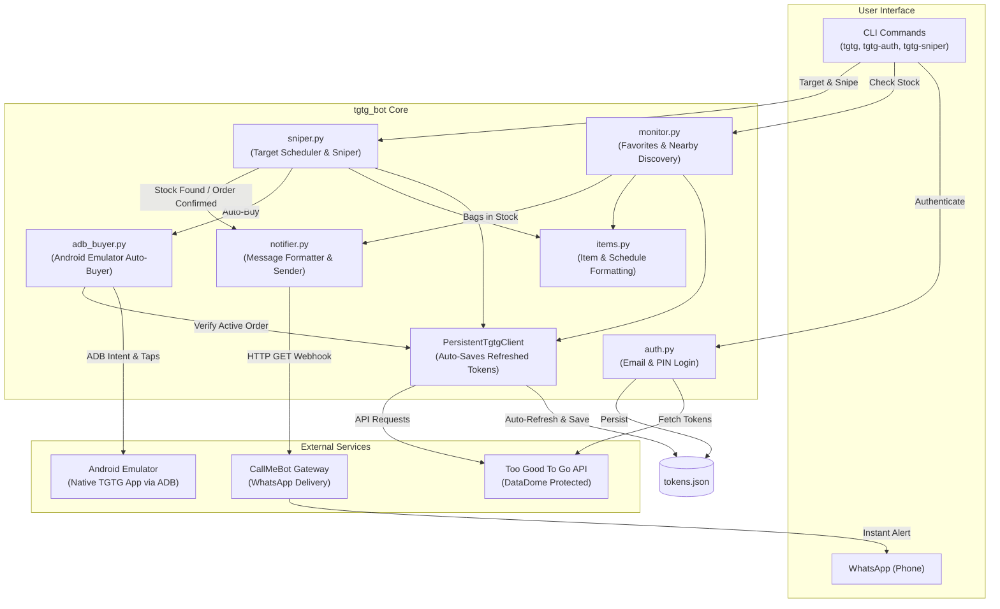

# Too Good To Go (TGTG) Bot, Sniper & WhatsApp Notifier

An intelligent automation tool for **Too Good To Go (TGTG)** that monitors favorite stores, discovers available surplus bags nearby, snipes scheduled drops with unattended Android app checkout via ADB, and sends instant notifications to your phone via WhatsApp.

---

## Table of Contents

- [Architecture & System Workflow](#architecture--system-workflow)
- [Features](#features)
- [System Requirements & Prerequisites](#system-requirements--prerequisites)
- [Android Studio & Emulator Setup (Step-by-Step)](#android-studio--emulator-setup-step-by-step)
- [Installation & Getting Started (Step-by-Step)](#installation--getting-started-step-by-step)
- [Usage Guide](#usage-guide)
  - [1. Authenticate with Too Good To Go](#1-authenticate-with-too-good-to-go)
  - [2. Monitor Favorites & Nearby Stores](#2-monitor-favorites--nearby-stores)
  - [3. Daily Drop Sniper](#3-daily-drop-sniper)
- [Calibration & Testing Tool](#calibration--testing-tool)
- [Configuration Reference (`.env`)](#configuration-reference-env)
- [Troubleshooting & FAQ](#troubleshooting--faq)
- [Running Tests](#running-tests)

---

## Architecture & System Workflow



---

## Features

1. **Passwordless Authentication with Anti-Bot Alignment (`auth.py`)**:
   * Authenticates with Too Good To Go via email verification link or PIN code.
   * Aligns user-agent headers with DataDome SDK fingerprints to prevent interstitial CAPTCHAs.
   * Stores session tokens securely in `tokens.json`.

2. **Persistent Session Management (`PersistentTgtgClient`)**:
   * Automatically refreshes expired access tokens and cookies.
   * Silently persists updated tokens to disk on every refresh, keeping your session permanently active without manual re-logins.

3. **Stock Monitoring & Discovery (`monitor.py`, `items.py`)**:
   * **Favorites Mode**: Scans your saved favorite stores, calculates real item prices from minor units, formats pickup windows and ratings, and displays stock status.
   * **Nearby Discovery (`--nearby`)**: Discovers any available surplus bags in your area using coordinates (auto-derived from your saved favorites or set manually).

4. **Daily Sniper & Multi-Bag Auto-Buyer (`sniper.py`, `adb_buyer.py`)**:
   * Reads exact drop times (`next_sales_window_purchase_start`) directly from store schedules.
   * Interactive startup menu displaying upcoming drops and badges for stores with no scheduled drops.
   * Allows picking bags to hunt with inline `index:quantity` syntax (e.g., `1:2, 2:1, 3:3`).
   * Prioritizes **in-stock bags first**, followed by upcoming drops in **chronological order** (earliest drop time first).
   * **Automated In-App Checkout**:
     - Pre-warms the target item page in the Android app 15 seconds before drop.
     - High-frequency burst polling near drop time with natural human jitter.
     - Taps the `+` stepper button on checkout to acquire requested quantities when surplus allows.
     - Inputs card security code (CVV), dismisses the soft keyboard, and confirms payment.
     - Verifies order transitions to `ACTIVE` state via API while excluding pre-existing active orders.
     - Retries checkout if transient issues occur and falls back to urgent WhatsApp alerts if auto-buy cannot complete.
   * **Sleep Prevention**: Automatically engages macOS `caffeinate` during snipe windows so your Mac does not go to sleep while waiting for drops.

5. **Instant WhatsApp Alerts (`notifier.py`)**:
   * Dispatches alerts via the free CallMeBot gateway to your WhatsApp number.
   * Formats messages with item details, prices, requested quantities, pickup windows, ratings, and deep links.

6. **Comprehensive Test Suite (`tests/`)**:
   * 104 unit and functional tests covering authentication, parsing, token persistence, notification delivery, ADB auto-buying with keyboard handling and stepper increments, and chronological multi-target quota sniping logic.

---

## System Requirements & Prerequisites

Before setting up the software, ensure your machine meets the following requirements:

| Component | Minimum Requirement | Recommended | Notes |
|:---|:---|:---|:---|
| **Operating System** | macOS 12+, Linux (Ubuntu 22.04+), or Windows 11 with WSL2 | **macOS (Apple Silicon M1/M2/M3/M4)** | macOS has built-in `caffeinate` support for background sleep prevention. |
| **Python** | Python 3.13+ | Python 3.13.5 | Check version with `python3 --version`. |
| **Package Tooling** | `uv` (recommended) or `pip` / `venv` | [**uv**](https://docs.astral.sh/uv/) | `uv` provides lightning-fast dependency resolution and virtual environments. |
| **Android Tools** | Android SDK Platform-Tools (`adb`) | Latest Platform-Tools | Required for controlling the emulator. |
| **Emulator** | Android Studio Virtual Device (AVD) | **Pixel 7 / 8 (1080x2400)** with **Google Play** | BlueStacks or Genymotion can also be used if configured with ADB. |
| **TGTG Account** | Active Too Good To Go account | Same account on mobile & bot | Must have a saved credit/debit card in the app. |
| **WhatsApp Alerts** | CallMeBot API key | Free | Quick one-time WhatsApp activation. |

---

## Android Studio & Emulator Setup (Step-by-Step)

The auto-buyer completes purchases directly inside the official Too Good To Go Android app using native Android Debug Bridge (ADB) taps. This completely bypasses DataDome web CAPTCHAs and processes orders with 100% native authenticity.

Follow these steps to set up Android Studio and your virtual device:

### Step 1: Install Android Studio & Platform Tools

#### On macOS:
Using Homebrew:
```bash
brew install --cask android-studio android-platform-tools
```
Or manually download from the official [Android Studio Website](https://developer.android.com/studio).

#### On Linux (Ubuntu/Debian):
```bash
sudo apt update
sudo apt install adb
# Download and install Android Studio from https://developer.android.com/studio
```

#### Verify ADB Installation:
Open your terminal and verify that `adb` is available:
```bash
adb version
```
> [!NOTE]
> On macOS, `tgtg_bot` automatically checks and appends `~/Library/Android/sdk/platform-tools` to your `PATH` if it is present.

---

### Step 2: Create an Android Virtual Device (AVD)

1. Open **Android Studio**.
2. From the welcome screen or main menu, open **Virtual Device Manager** (or go to **Tools → Device Manager**).
3. Click **Create Device** (the `+` button).
4. **Choose Device Definition:**
   * Select **Phone** in the category list.
   * Select **Pixel 7** or **Pixel 8** (Screen resolution: **1080 × 2400**, ~420 dpi).
   * *Why Pixel 7 / 8?* The default touch coordinates in `adb_buyer.py` are calibrated to a 1080 × 2400 aspect ratio, giving you out-of-the-box accuracy without manual calibration.
   * Click **Next**.
5. **Select System Image (CRITICAL):**
   * Choose **Android 14 (API 34)** or **Android 13 (API 33)**.
   * Select the architecture matching your machine:
     - **ARM64 (arm64-v8a)** on Apple Silicon Macs (M1/M2/M3/M4).
     - **x86_64** on Intel Macs, Linux, or Windows x64.
   * **IMPORTANT**: Ensure the system image has the **Google Play** icon next to it.
     > Standard "AOSP" images without Google Play **do not** include the Google Play Store or Google Play Services, which are required to download and run Too Good To Go.
   * Click the download icon next to the release if not already downloaded, then select it and click **Next**.
6. **Verify Configuration:**
   * Name your device (e.g. `Pixel_7_API_34`).
   * Under **Emulated Performance**, set Graphics to **Hardware - GLES 2.0** (or Automatic).
   * Click **Finish**.

---

### Step 3: Boot Emulator & Install Too Good To Go

1. In the Device Manager, click the **Play (▶)** button next to your virtual device to start it.
   *(Alternatively, launch it from your terminal:)*
   ```bash
   ~/Library/Android/sdk/emulator/emulator -avd Pixel_7_API_34 &
   ```
2. Wait for the emulator to finish booting to the Android home screen.
3. Open the **Google Play Store** on the emulator.
4. Sign in with your Google account.
5. Search for **Too Good To Go** and click **Install**.
6. Once installed, open the **Too Good To Go** app.

---

### Step 4: Sign In and Configure Saved Payment Method

1. Inside the Too Good To Go app on the emulator, sign in to your Too Good To Go account.
   > **Note:** Use the same email address you will use for the bot.
2. Go to your **Profile** tab (bottom right) → tap the **Settings (gear icon)** → **Payment Methods**.
3. Add your credit or debit card.
4. **Enable "Save for future purchases"** so the card is saved on your account.
5. **Identify your Card Security Code (CVV):**
   * Too Good To Go prompts for your card's 3-digit CVV code on the final checkout screen.
   * You will supply this CVV in your `.env` file via `TGTG_SECURITY_CODE` so the auto-buyer can complete payments automatically.

---

### Step 5: Verify ADB Connectivity

Keep the emulator running and run this in your terminal:
```bash
adb devices
```
You should see your emulator listed as online:
```text
List of devices attached
emulator-5554    device
```

Run the built-in calibration script to confirm screen resolution and touch readiness:
```bash
uv run python scripts/calibrate_adb.py
```
You should see:
```text
✅ Emulator connected: emulator-5554
📱 Screen resolution: 1080x2400 (matches default Pixel 7 profile)
```

---

## Installation & Getting Started (Step-by-Step)

### Step 1: Clone Repository & Install Dependencies

Ensure Python 3.13+ and `uv` are installed:
```bash
# Install uv if you don't have it:
curl -LsSf https://astral.sh/uv/install.sh | sh
# Or on macOS with Homebrew:
brew install uv
```

Clone the repository and install all dependencies into a managed virtual environment:
```bash
git clone git@github.com:felix1028/tgtg.git
cd tgtg
uv sync
```

---

### Step 2: Configure Environment Variables

Create your `.env` configuration file from the template:
```bash
cp .env.example .env
```

Open `.env` in your text editor:
```env
# Your Too Good To Go account email
TGTG_EMAIL=your_email@example.com

# Credentials will be populated automatically when running tgtg-auth
TGTG_ACCESS_TOKEN=
TGTG_REFRESH_TOKEN=
TGTG_COOKIE=

# Notification options (WhatsApp via CallMeBot)
WHATSAPP_PHONE=
WHATSAPP_APIKEY=

# Card Security Code (CVV) for automated native checkout
TGTG_SECURITY_CODE=123
```

---

### Step 3: Set Up Free WhatsApp Alerts (CallMeBot)

To receive real-time notifications when bags are detected or purchased:
1. Add the CallMeBot contact **`+34 684 770 005`** to your phone contacts (or click the [CallMeBot WhatsApp Link](https://wa.me/34684770005?text=I%20allow%20callmebot%20to%20send%20me%20messages)).
2. Send this exact message:
   ```text
   I allow callmebot to send me messages
   ```
3. CallMeBot will instantly reply with your personal `APIKEY`.
4. Add your phone number (with country code, e.g. `+1234567890`) and the received `APIKEY` to `.env`:
   ```env
   WHATSAPP_PHONE=+1234567890
   WHATSAPP_APIKEY=1234567
   ```

---

### Step 4: Authenticate with Too Good To Go

Run the passwordless authentication workflow:
```bash
uv run tgtg-auth
# or:
uv run python -m tgtg_bot.auth
```
1. If `TGTG_EMAIL` is not set in `.env`, you will be prompted to enter your account email.
2. Check your email inbox on your phone or computer.
3. Click the login link or enter the verification PIN when prompted.
4. Your authenticated session tokens are automatically saved to `tokens.json`.

---

## Usage Guide

### 1. Authenticate with Too Good To Go

If your session ever expires or you want to switch accounts:
```bash
uv run tgtg-auth
```

---

### 2. Monitor Favorites & Nearby Stores

#### Check Saved Favorites:
Checks all stores you have favorited (hearted) in the Too Good To Go app:
```bash
uv run tgtg
# or:
uv run python -m tgtg_bot.monitor
```
Displays current stock status, prices, ratings, and pickup times. If bags are in stock, an alert is sent to your WhatsApp.

#### Scan All Nearby Stores:
Scans the surrounding geographic area for all stores with available surplus bags:
```bash
uv run python -m tgtg_bot.monitor --nearby

# Optional: customize radius in km (default: 10km)
uv run python -m tgtg_bot.monitor --nearby --radius 15
```

---

### 3. Daily Drop Sniper

The daily drop sniper allows you to select targets for the day and automatically snipes scheduled drops down to the millisecond.

#### Mode A: 100% Unattended Auto-Buy Mode (Default)
With your Android emulator running:
```bash
uv run tgtg-sniper
# or:
uv run python -m tgtg_bot.sniper
```

The bot will:
1. Fetch all your favorite stores and their scheduled drop times for today.
2. Display an interactive menu:
   ```text
   ======================================================================
   🎯 Too Good To Go — Daily Target Selection
   ======================================================================
   [ 1] Tartine Bakery
        Bag: Surprise Bag ($5.99) | ⭐ 4.8 (120)
        Pickup: 🧺 Today 8:00 PM - 8:30 PM
        Status: ❌ Sold out | 🕒 Drops at 07:15 PM

   [ 2] Arsicault Bakery
        Bag: Pastry Bag ($4.99) | ⭐ 4.9 (250)
        Pickup: 🧺 Today 3:30 PM - 4:00 PM
        Status: ❌ Sold out | 🕒 Drops at 03:00 PM
   ```
3. Enter your choices with desired quantities:
   * **Single bag per store:** `1, 2`
   * **Multiple bags per store:** `1:2, 2:1` (requests 2 bags from Store 1, 1 bag from Store 2)
4. The sniper organizes targets **chronologically**, sleeps with 0% CPU until 15 seconds before drop time, engages macOS sleep prevention (`caffeinate`), pre-warms the app in the emulator, initiates burst polling, increments the `+` stepper button for multi-bag orders, enters your CVV, and confirms payment.
5. Sends an instant WhatsApp notification confirming the order!

#### Skip the Prompt (CLI Flags):
```bash
# Target store 1 (2 bags) and store 2 (1 bag) automatically:
uv run python -m tgtg_bot.sniper --top 1:2,2:1

# Target stores 1 and 2 (1 bag each):
uv run python -m tgtg_bot.sniper --top 1,2
```

#### Mode B: Alert-Only Mode (`--no-auto-buy`)
If you prefer to checkout manually on your physical phone:
```bash
uv run tgtg-sniper --no-auto-buy
```
When a drop occurs, the sniper immediately sends a WhatsApp alert with a direct deep-link and plays a macOS alert chime so you can tap and buy immediately.

#### Additional Sniper Options:
```bash
# Adjust drop observation window in seconds (default: 120s):
uv run python -m tgtg_bot.sniper --window 180

# Target a specific ADB device if multiple are connected:
uv run python -m tgtg_bot.sniper --device emulator-5554
```

---

## Calibration & Testing Tool

The repository includes a dedicated diagnostic and calibration utility [`scripts/calibrate_adb.py`](file:///Users/marianascott/projects/tgtg/scripts/calibrate_adb.py):

```bash
# 1. Test ADB connectivity and screen resolution:
uv run python scripts/calibrate_adb.py

# 2. Test opening a specific item deep-link in the TGTG Android app:
uv run python scripts/calibrate_adb.py --item-id 1572973

# 3. Capture an emulator screenshot to inspect UI state:
uv run python scripts/calibrate_adb.py --screenshot current_screen.png

# 4. Dry-run test taps (simulates clicking Reserve, Stepper, and Pay without placing an order):
uv run python scripts/calibrate_adb.py --test-taps
```

---

## Configuration Reference (`.env`)

| Variable | Required | Default | Description |
|:---|:---:|:---:|:---|
| `TGTG_EMAIL` | Yes | - | Your Too Good To Go account email. |
| `TGTG_ACCESS_TOKEN` | Auto | - | Access token generated by `tgtg-auth`. |
| `TGTG_REFRESH_TOKEN` | Auto | - | Refresh token generated by `tgtg-auth`. |
| `TGTG_COOKIE` | Auto | - | Session cookie generated by `tgtg-auth`. |
| `WHATSAPP_PHONE` | Optional | - | Phone number with country code (e.g. `+1234567890`) for CallMeBot alerts. |
| `WHATSAPP_APIKEY` | Optional | - | Personal API key obtained from CallMeBot. |
| `TGTG_SECURITY_CODE` | Optional | `876` | Card CVV / security code to input on the checkout screen. |
| `TGTG_ADB_DEVICE` | Optional | First online | Target ADB device identifier (e.g. `emulator-5554`). |
| `TGTG_ADB_RESERVE_X` | Optional | `0.720` | Relative X coordinate ratio for the "Reserve" button. |
| `TGTG_ADB_RESERVE_Y` | Optional | `0.898` | Relative Y coordinate ratio for the "Reserve" button. |
| `TGTG_ADB_GOT_IT_X` | Optional | `0.500` | Relative X coordinate ratio for the "Got it!" disclaimer button. |
| `TGTG_ADB_GOT_IT_Y` | Optional | `0.864` | Relative Y coordinate ratio for the "Got it!" disclaimer button. |
| `TGTG_ADB_CONFIRM_X` | Optional | `0.665` | Relative X coordinate ratio for "Confirm & Pay" button. |
| `TGTG_ADB_CONFIRM_Y` | Optional | `0.713` | Relative Y coordinate ratio for "Confirm & Pay" button. |
| `TGTG_ADB_CVV_X` | Optional | `0.740` | Relative X coordinate ratio for the CVV input field. |
| `TGTG_ADB_CVV_Y` | Optional | `0.806` | Relative Y coordinate ratio for the CVV input field. |
| `TGTG_ADB_SECOND_PAY_X` | Optional | `0.500` | Relative X coordinate ratio for the final Pay confirmation button. |
| `TGTG_ADB_SECOND_PAY_Y` | Optional | `0.899` | Relative Y coordinate ratio for the final Pay confirmation button. |
| `TGTG_ADB_PLUS_X` | Optional | `0.293` | Relative X coordinate ratio for the `+` quantity stepper button. |
| `TGTG_ADB_PLUS_Y` | Optional | `0.713` | Relative Y coordinate ratio for the `+` quantity stepper button. |

---

## Troubleshooting & FAQ

### 1. `adb: command not found`
* **Fix:** Make sure Android Platform-Tools are installed (`brew install --cask android-platform-tools` on macOS).
* If installed via Android Studio, add platform tools to your shell profile (`~/.zshrc` or `~/.bashrc`):
  ```bash
  export PATH="$HOME/Library/Android/sdk/platform-tools:$PATH"
  ```

### 2. `No Android devices or emulators attached`
* **Fix:** Ensure your emulator is booted and running. Run `adb devices` in terminal.
* If using a physical phone, ensure **USB Debugging** is enabled in Developer Options.

### 3. Google Play Store is missing in the emulator
* **Fix:** When creating the AVD in Android Studio Device Manager, select a system image that specifically includes the **Google Play Store icon**. Standard AOSP images do not include Google Play Services or the Play Store.

### 4. Too Good To Go displays a blank screen or won't log in on the emulator
* **Fix:** Make sure the emulator has an active internet connection. In Android Studio AVD settings, verify DNS settings. If using a VPN on your host machine, try temporarily disconnecting it while logging in.

### 5. Buttons are tapped in the wrong location on my screen
* **Fix:** If your emulator uses a different resolution than 1080 × 2400:
  1. Capture a screenshot during checkout:
     ```bash
     uv run python scripts/calibrate_adb.py --screenshot screen.png
     ```
  2. Inspect the pixel coordinates of the buttons.
  3. Divide pixel coordinates by screen width and height (e.g. $X / 1080, Y / 2400$) to find the ratio.
  4. Override the specific button ratios in your `.env` file using `TGTG_ADB_*` variables (see [Configuration Reference](#configuration-reference-env)).

### 6. Will my Mac go to sleep while waiting for a drop hours away?
* **No.** When the sniper starts, it automatically spawns macOS `caffeinate` to prevent system and display sleep until all target drops conclude.

---

## Running Tests

The test suite includes 104 unit and functional tests validating the entire pipeline without making live API requests or placing real orders:

```bash
uv run pytest
```

To run a specific test suite:
```bash
# Test ADB auto-buyer and stepper mechanics:
uv run pytest tests/test_adb_buyer.py

# Test chronological sniper and quota tracking:
uv run pytest tests/test_sniper.py

# Test monitor and items parser:
uv run pytest tests/test_monitor.py
```
