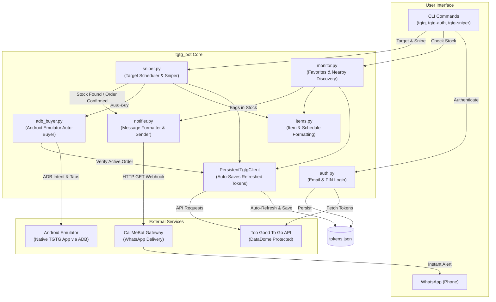

# Too Good To Go (TGTG) Bot, Sniper & WhatsApp Notifier

An intelligent automation tool for **Too Good To Go (TGTG)** that monitors favorite stores, discovers available surplus bags nearby, snipes scheduled drops with auto-reservation, and sends instant notifications to your phone via WhatsApp.

---

## Architecture & System Workflow



---

## Features & Implemented Plan

1. **Passwordless Authentication with Anti-Bot Alignment (`auth.py`)**:
   * Authenticates with Too Good To Go via email verification link or PIN code.
   * Matches mobile user-agent headers with DataDome SDK fingerprints to prevent interstitial CAPTCHAs.
   * Stores session tokens securely in `tokens.json`.

2. **Persistent Session Management (`PersistentTgtgClient`)**:
   * Automatically refreshes expired access tokens and cookies.
   * Silently persists updated tokens to disk on every refresh, keeping your session permanently active without manual re-logins.

3. **Stock Monitoring & Discovery (`monitor.py`, `items.py`)**:
   * **Favorites Mode**: Scans your saved favorite stores, calculates real item prices from minor units, formats pickup windows and ratings, and displays stock status.
   * **Nearby Discovery (`--nearby`)**: Discovers any available surplus bags in your area using coordinates (auto-derived from your saved favorites or set manually).

4. **Daily Sniper & Multi-Bag Auto-Buyer (`sniper.py`, `adb_buyer.py`)**:
   * Reads exact drop times (`next_sales_window_purchase_start`) directly from the store's schedule.
   * Displays an interactive startup menu showing upcoming drops and badges for stores with no scheduled drops.
   * Allows picking up to 3 bags to hunt for the day using inline `index:quantity` syntax (e.g., `1:2, 2:2, 3:1`).
   * Automatically organizes targets with **currently available stock first**, followed by upcoming drops in **chronological order** (earliest drop time first).
   * **Multi-Bag Procurement**:
     - Session bag quota automatically equals the sum of requested per-target quantities.
     - Seeds pre-existing active orders at startup (`exclude_order_ids`) so existing reservations are never mistaken for new purchases.
     - In Auto-Buy mode (default), taps the `+` stepper on the in-app checkout screen to buy multiple bags in one transaction when surplus stock allows, dismisses the soft keyboard after CVV entry, and verifies the new order transitions to `ACTIVE`.
     - Keeps hunting remaining scheduled drops (including overlapping/back-to-back drop windows) until your total bag quota is fulfilled.
   * Sleeps with 0% CPU until 30 seconds before drop time, pre-warms the target item page on the emulator, and initiates rapid checks with natural human-like jitter.
   * Retries checkout on transient failure during the drop window and falls back to sending an urgent WhatsApp deep-link alert if auto-buy fails.
   * Exits cleanly as soon as your bag goal is secured.

5. **Instant WhatsApp Alerts (`notifier.py`)**:
   * Dispatches alerts via the CallMeBot gateway to your personal WhatsApp number.
   * Formats messages with item details, prices, requested quantities, and stock counts.

6. **Comprehensive Test Suite (`tests/`)**:
   * 103 unit and functional tests covering authentication, parsing, token persistence, notification delivery, ADB auto-buying with keyboard handling and stepper increments, and chronological multi-target quota sniping logic.

---

## Technologies Applied

| Technology | Purpose |
|:---|:---|
| **Python 3.13+** | Core runtime environment. |
| **[uv](https://docs.astral.sh/uv/)** | Fast package management, script execution, and virtualenv tooling. |
| **[tgtg-python](https://github.com/ahivert/tgtg-python)** | Reverse-engineered client wrapper for the unofficial Too Good To Go API. |
| **Requests** | HTTP client for interacting with the CallMeBot notification API. |
| **python-dotenv** | Environment configuration management for credentials. |
| **pytest & unittest.mock** | Test suite ensuring reliability without making live API calls. |
| **CallMeBot API** | Outbound WhatsApp delivery service for personal mobile alerts. |

---

## Project Structure

```text
tgtg/
├── .env.example          # Template for environment variables
├── pyproject.toml        # Project dependencies, metadata & CLI entrypoints
├── tokens.json           # Cached authentication tokens (git-ignored)
├── scripts/
│   └── calibrate_adb.py  # ADB emulator testing & button calibration tool
├── tests/                # Complete test suite (103 tests)
│   ├── conftest.py       # Fixtures & mock payloads
│   ├── test_adb_buyer.py # ADB emulator touch & auto-checkout tests
│   ├── test_auth.py      # Authentication flow tests
│   ├── test_functional.py# End-to-end monitor workflow tests
│   ├── test_monitor.py   # Parsing, client retrieval & persistence tests
│   ├── test_notifier.py  # WhatsApp notification tests
│   └── test_sniper.py    # Chronological scheduling & multi-bag sniper tests
└── src/
    └── tgtg_bot/
        ├── __init__.py
        ├── adb_buyer.py  # Android emulator auto-buyer via native ADB taps
        ├── auth.py       # Passwordless login & token management
        ├── items.py      # Item payload parsing, price & pickup formatting
        ├── monitor.py    # Favorites check, nearby scanner & persistent client
        ├── notifier.py   # WhatsApp message formatting & delivery
        └── sniper.py     # Scheduled drop watcher & multi-bag procurement
```

---

## How to Use

### 1. Requirements & Setup

Install dependencies using `uv`:
```bash
uv sync
```

Copy the example environment file:
```bash
cp .env.example .env
```

---

### 2. Configure WhatsApp Alerts (CallMeBot)

To receive alerts on WhatsApp when bags become available:
1. Add the CallMeBot number **`+34 684 770 005`** to your phone contacts (or open the [CallMeBot WhatsApp link](https://wa.me/34684770005?text=I%20allow%20callmebot%20to%20send%20me%20messages)).
2. Send the message: `I allow callmebot to send me messages`
3. CallMeBot will reply with your personal `APIKEY`.
4. Add your phone number and API key to `.env`:
   ```env
   WHATSAPP_PHONE=+1234567890       # Your international phone number
   WHATSAPP_APIKEY=XXXXXX           # Your CallMeBot API key
   ```

---

### 3. Authenticate with Too Good To Go

Run the authentication script once:
```bash
uv run tgtg-auth
# or:
uv run python -m tgtg_bot.auth
```
* Enter your account email (or define `TGTG_EMAIL=your_email@example.com` in `.env`).
* Check your email for the login PIN or confirmation link.
* Once confirmed, credentials are saved to `tokens.json`.

---

### 4. Running the Monitor

#### Check Saved Favorites
```bash
uv run tgtg
# or:
uv run python -m tgtg_bot.monitor
```
Checks all favorite stores saved in your Too Good To Go mobile app. If any bags are in stock, it sends an instant WhatsApp alert.

#### Scan All Nearby Stores
```bash
uv run python -m tgtg_bot.monitor --nearby

# Optional: customize radius in km (default: 10km)
uv run python -m tgtg_bot.monitor --nearby --radius 15
```
Automatically centers on your area (derived from your saved favorites or custom coordinates) and scans all stores with bags currently in stock.

---

### 5. Running the Daily Sniper

#### Mode A: 100% Unattended Auto-Buy Mode (`--auto-buy`, Default)
Automatically purchases the bag in the official Too Good To Go Android app running in an emulator via ADB:
```bash
uv run tgtg-sniper
# or with predetermined target choices:
uv run python -m tgtg_bot.sniper --top 1,2,3
```
* **Instant In-App Checkout:** Executes taps on "Reserve", "Got it!", optionally increases quantity via the `+` stepper button, enters your card's security code / CVV (`876` default, customizable via `TGTG_SECURITY_CODE`), dismisses the soft keyboard, and confirms with the second Pay button.
* **Order Verification:** Confirms order state via API (`ACTIVE`) before concluding, excluding any pre-existing active orders from earlier in the day.
* **Safety Fallback:** If auto-buy fails repeatedly during the drop window while stock is available, it automatically dispatches a fallback WhatsApp deep-link alert and macOS sound chime so you can buy manually.

#### Mode B: Alert-Only Mode (`--no-auto-buy`)
Skips ADB checkout and sends high-priority WhatsApp alerts with a direct universal link and macOS notification sound:
```bash
uv run tgtg-sniper --no-auto-buy
# or:
uv run python -m tgtg_bot.sniper --no-auto-buy --top 1,2,3
```

#### Procuring Multiple Bags (Per-Target Quantities)
You can set specific quantities for each chosen store directly using inline `index:quantity` syntax (e.g. 2 of the 1st bag, 1 of the 2nd bag, 3 of the 3rd bag):
```bash
# Custom quantity per bag using inline 'index:quantity' syntax:
uv run python -m tgtg_bot.sniper --auto-buy --top 1:2,2:1,3:3

# Or single quantities (1 per store):
uv run python -m tgtg_bot.sniper --auto-buy --top 1,2,3

# Interactive Mode (enter targets with quantities directly at the prompt):
uv run python -m tgtg_bot.sniper --auto-buy
# Prompt: Enter up to 3 bags to target today: 1:2, 2:1, 3:3
```
* **Per-Target Execution:** When each store drop occurs, the bot automatically buys up to that specific store's target quantity (tapping the `+` stepper in the app if stock permits).
* **Session Goal:** The session goal automatically equals the sum of requested bag quantities. The sniper tracks acquired bags and continues down your chronological schedule until your target total is fulfilled.
* **Duplicate Prevention:** Tracks previous active order IDs so follow-up drop verification only recognizes new purchases.

---

### 6. Setting Up the Android Emulator & ADB Calibration

#### Prerequisites
1. **ADB:** Already installed via `brew install --cask android-platform-tools`.
2. **Android Emulator:** Install Android Studio (`brew install --cask android-studio`), Genymotion, or BlueStacks for Mac.
   - In Android Studio Device Manager, create a virtual device (e.g. Pixel 7 / Pixel 8, ARM64 system image).
   - Start the emulator, open Google Play, and install **Too Good To Go**.
   - Log into your account and save a credit/debit card under **Profile → Settings → Payment Methods** (check *"Save for future purchases"*).

#### Testing & Calibrating ADB
Run the calibration script to test connectivity and button coordinates:
```bash
# 1. Verify connection and display resolution:
uv run python scripts/calibrate_adb.py

# 2. Test opening an item deep link in the app:
uv run python scripts/calibrate_adb.py --item-id 1572973

# 3. Take a screenshot for verification:
uv run python scripts/calibrate_adb.py --screenshot test_screen.png

# 4. Dry-run test taps:
uv run python scripts/calibrate_adb.py --test-taps
```

---

### 7. Running Tests

To run the complete test suite:
```bash
uv run pytest
```
